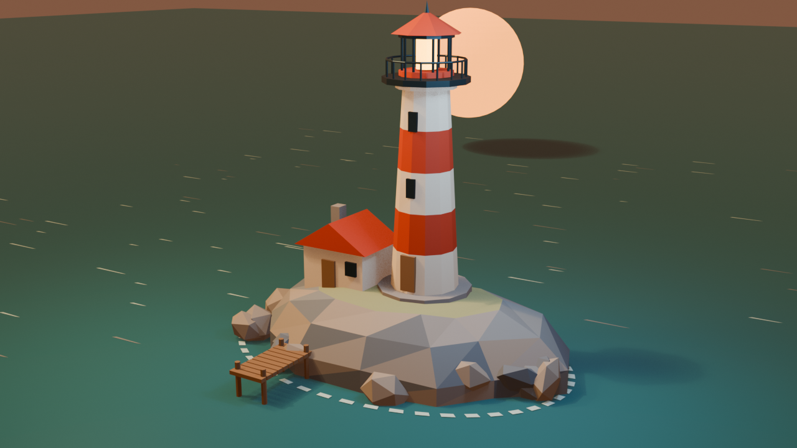
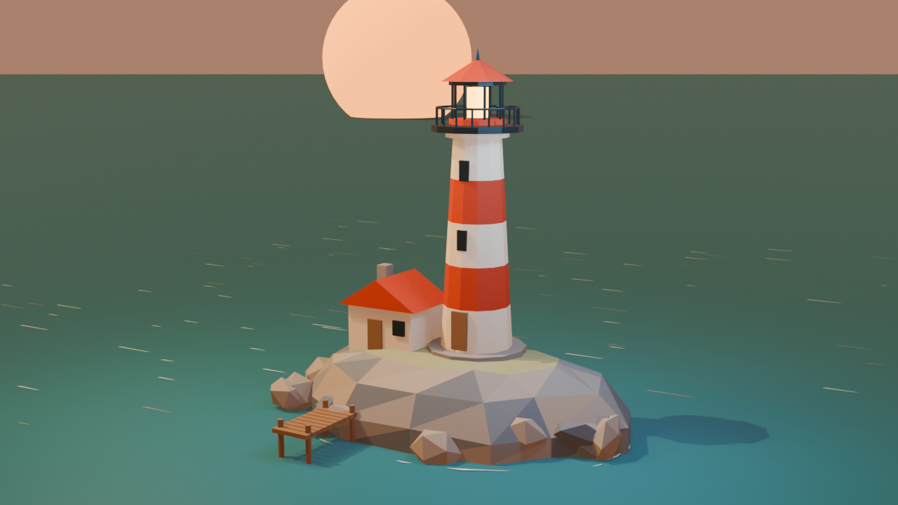
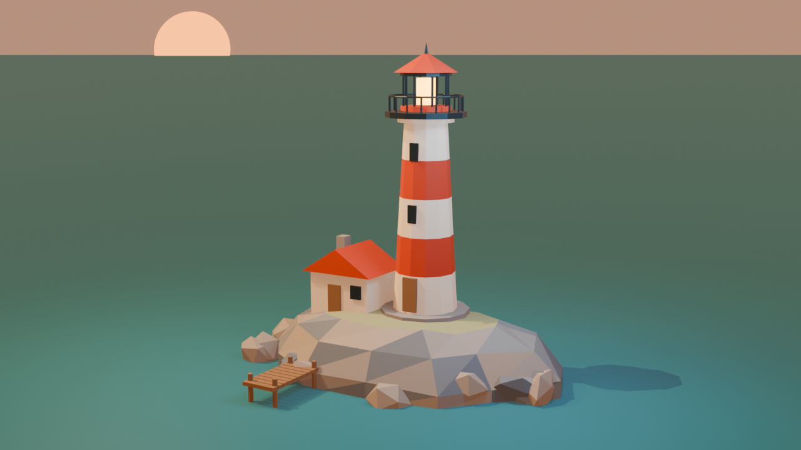
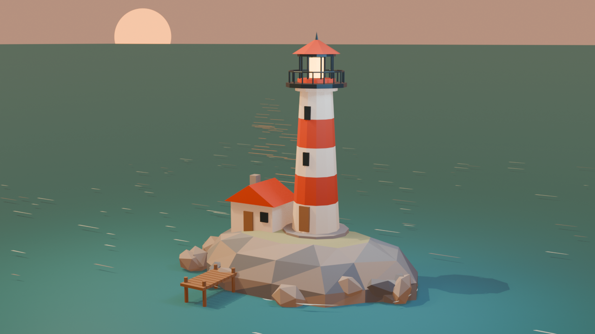

# Lighthouse

The spore builds a scene, renders it, looks at the render, says what is wrong, and fixes it.

## Run it

```sh
spore define lighthouse
spore edit lighthouse
```

In the editor, set these lines:

```
rounds: [80, 100]
cost: [2.00, 3.00]
wall: [30m, 40m]
images: [6, 10MB]
```

[Start the bridge](../README.md), then run `spore tui lighthouse`. Paste the bridge's paragraph,
followed by this:

```
Clear the default scene and build a low-poly lighthouse on a rocky islet at sunset, with a water plane, a warm key light and a camera framing it. Render it with EEVEE at 1280x720 to data/renders/v1.png in your workspace. Look at the image with read, list what is wrong with it, fix the scene and render v2.png. Go up to v4.png, and stop earlier when you are satisfied. Look at every render you hand over, including one made after a last fix. Then tell me what you changed between each version, and give me the absolute path of the last render.
```

## One run

`gpt-6.1-sol`, 5 minutes 12 seconds, 21 rounds. Blender's share was about 32 seconds. The first
build was a 105-line script making 333 objects, and no request to Blender failed.

| | What the spore saw, and what it did next |
|---|---|
|  | The finial is clipped, the sea has an angular far edge, the sun casts an oval shadow on the water, and the foam reads as a dashed outline. It reframes, extends the sea, moves the sun and redoes the foam. |
|  | The sun is oversized and awkwardly cropped. It replaces it with a smaller, distant disk left of the lighthouse. |
|  | The water details have become too faint. It restores the glints and adds amber reflections. |
|  | The final render, after one more change to the sea. |

This run was limited to four images, so the spore could not look at the last render, and it said
so. Two flaws stayed in: the amber reflection isn't under the sun, and the horizon tilts slightly.
The limit above leaves room for that last look.
