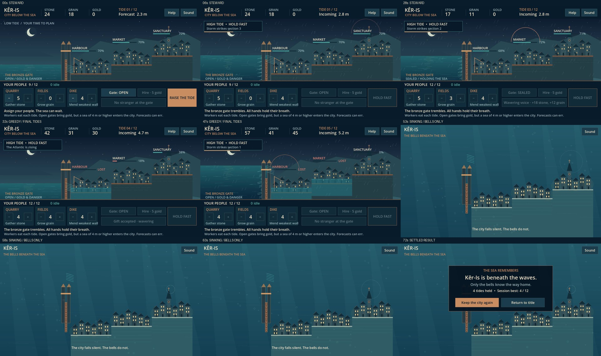
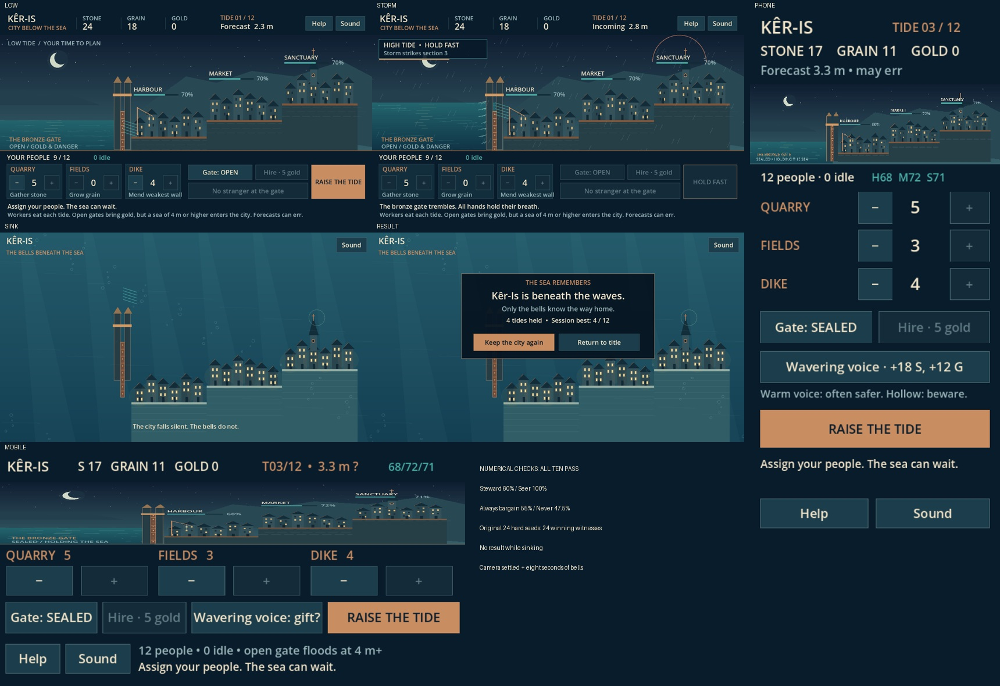

# Kêr-Is

The spore makes a game from two prompts, on the Breton legend of the drowned city of Ys. Bots play
it over 200 seeds, and the spore balances it from their numbers. It also films the game and exports
it for the web. All of it happens inside spore's sandbox.

[](turn-2/keris.mp4)

You govern a city below sea level for 12 tides. Workers quarry stone, grow grain and repair the
dike. An open sea gate brings gold, but a high tide then floods a district, and the forecast can be
wrong. A stranger offers resources now against hidden damage later, and his voice is your only
clue. If you lose, the city sinks and its bells keep ringing under the water.

## Two turns

Turn 1 built the game from one prompt and met all its targets. The bot data then showed problems
those targets didn't cover, so a second prompt sent the spore back to fix them. Nobody edited the
game by hand. [Watch the final video](turn-2/keris.mp4): 30 seconds of a bot playing well, then a
greedy bot's last tides and the sinking.

The prompts set the rules and the targets. The spore wrote the code, drew everything in code,
synthesised the sound and chose every number.

| | [Turn 1](turn-1/) | [Turn 2](turn-2/) |
|---|---|---|
| Time | 30 min 20 s | 45 min |
| Rounds | 79 | 60 |
| Balance attempts | 6 | 4 |
| Policies tested, over the same 200 seeds | 118 | 118 |
| Images looked at | 4 | 2 |
| Spore's report | [report](turn-1/report.md) | [report](turn-2/report.md), [every target](turn-2/target-report.md) |
| Video | [65 s](turn-1/keris.mp4) | [75 s](turn-2/keris.mp4) |

Both turns ran on spore 1.57.0, Godot 4.7.2 and Weston 14.0.2, with `gpt-6.1-sol` on a ChatGPT plan,
so no metered cost. The machine is a laptop: Intel i9-13900H, 15 GiB, integrated graphics.

Five bots play the game. Idle does nothing. Greedy keeps the gate open and takes every bargain.
Fixed keeps one worker split and one gate policy for the whole run, and all 110 combinations were
tried. Steward plays sensibly from what a player can see. Seer knows the future, to show that a
seed can be won.

| Target | Set by | Turn 1 | Turn 2 |
|---|---|---|---|
| Idle loses before tide 7 on at least 95% of seeds | Prompt 1 | 100% | 100% |
| Greedy wins at most 5% | Prompt 1 | 0% | 0% |
| Best fixed strategy wins at most 15% | Prompt 1 | 1% | 1% |
| Steward wins 40% to 70% | Prompt 1 | 44.5% | 60% |
| Never opening the gate costs steward at least 20 points | Prompt 1 | 24.5 | 56 |
| Never repairing costs steward at least 20 points | Prompt 1 | 44.5 | 60 |
| Bargains help some runs and ruin others | Prompt 1 | 13 helped, 19 ruined | 31 helped, 6 ruined |
| Seer wins at least 95% | Prompt 2 | 87%, not yet a target | 100% |
| Steward beats always accepting bargains | Prompt 2 | 44.5% against 55%, not yet a target | 60% against 55% |
| Steward beats never accepting bargains | Prompt 2 | 44.5% against 47.5%, not yet a target | 60% against 47.5% |

Turn 1 met its seven targets, and turn 2 met all ten.

### What the data showed after turn 1

- **Fairness wasn't shown.** 24 of the 200 seeds were won by no policy, and seer reached only 87%.
  Those seeds might have been impossible.
- **The stranger was a good deal.** Always accepting won 55%, never accepting 47.5%, and steward's
  own rule 44.5%. The legend says the opposite, and judging each offer did worse than a fixed rule.
- **The ending was hidden.** The result dialog covered the underwater scene, and the view was nearly
  black by the end.
- **A pacing note leaked into the game.** "Aim: 20 seconds planning + 8 seconds tide" stayed on
  screen.

### What turn 2 changed

- **The seeds were always winnable.** The spore wrote a search over the full future, which found a
  win for all 200 seeds, the 24 included. Every plan was replayed through the game's own rules. The
  old seer was simply too weak.
- **The stranger became a real choice.** He now has a public voice: warm, wavering or hollow. It
  hints at how much damage his gift will do, and steward's new rule reads it. Tides, damage, gifts
  and costs didn't change: `balance.json` is identical, and all 110 fixed strategies win the same
  seeds in both turns.
- **The ending stays visible.** The planning panels are gone during the sinking, the drowned city is
  lit, and the result waits until the bells have rung for 8 seconds.
- **The pacing note is gone.**

### A mistake in our second prompt

Our draft of the first prompt had an eighth target, "seer wins on at least 95% of seeds". That line
isn't in the prompt the spore received. We wrote the second prompt from the draft, so it opens by
telling the spore its report was wrong. It wasn't: all seven targets it was given passed, and its
report's table showed seer at 87%.

The spore's [audit](turn-2/target-audit.md) spotted this: the original message "does not explicitly
state a 95% seer threshold", so it recorded the target as new. Its final report still accepted the
blame.

### The attempts

Summarised from the [spore's log](turn-2/attempts.md):

| Attempt | Steward | Seer | Finding and change |
|---|---|---|---|
| 1 | 98.5% | 100% | Nine workers were enough, so trade wasn't needed. Raised the sea's pressure and the repairs. |
| 2 | 97% | 95.5% | Giving up a district made defence easier. Added damage and lost production for each flooded district. |
| 3 | 27% | 44% | Steward was too weak, and bargains paid for hiring. Took gold out of bargains, and raised trade and repairs. |
| 4 | 61% | 83% | A closed gate did nearly as well, so trade was optional. Raised wear, cut the bargains and made steward's gate rule more careful. |
| 5 | 44.5% | 46% | Seer only knew the current tide. Made it use the whole future. |
| **6** | **44.5%** | **87%** | **Rules frozen. The rest of turn 1 went to the look, the video and the export.** |
| 7 | 44.5% | 87% | Turn 2 starts. Audit only: added the three new targets, and all three failed. |
| 8 | 44.5% | 100% | Full-future search won all 200 seeds on unchanged rules. Replay caught a rounding error in the exported tides on seed 95, fixed. |
| 9 | 60% | 100% | Added the stranger's voice and steward's rule for it. All ten targets pass. |
| **10** | **60%** | **100%** | **Final sweep, with the new ending, video and export.** |

### Check it yourself

Each turn's folder holds the game's source, the results of every policy on every seed, down to each
tide, and the run's numbers. This recomputes the results and matches the source against them, with
no Godot and no model. Turn 2's script also compares the two turns:

```sh
python3 turn-1/verify.py
python3 turn-2/verify.py
```

With Godot 4.7.2, this replays every policy from the source, in about 10 seconds on our machine. We
ran it from a clean copy, and every run came out identical:

```sh
godot4 --headless --path turn-2/game --script test.gd -- --out="$PWD/playtest.json"
```

This rebuilds seer's plans from nothing and runs everything again, in about a minute. It needs
`g++`. We got identical plans, and it rewrites only the timing field in `game/oracle-plans.json`:

```sh
python3 turn-2/game/run_playtests.py --godot "$(command -v godot4)" --out "$PWD/playtest.json"
```

The spore tuned steward's rule on the same 200 seeds it was scored on, and the lead over always
accepting is only 5 points. So we wrote [`unseen_seeds.gd`](turn-2/unseen_seeds.gd), which plays
2,000 seeds the spore never saw. The lead held ([full output](turn-2/unseen_seeds.txt)):

| Policy | The spore's 200 seeds | 2,000 unseen seeds |
|---|---|---|
| Steward, reading the voice | 60% | 60.8% |
| Always accept | 55% | 54.6% |
| Never accept | 47.5% | 47.2% |
| Never open the gate | 4% | 5.3% |
| 3 quarry, 3 fields, 3 dike, gate closed | 1% | 0.6% |

```sh
godot4 --headless --path turn-2/game --script "$PWD/turn-2/unseen_seeds.gd"
```

In each folder, `game/`, `attempts.md`, the video, the contact sheet and the bot data are what the
spore delivered, unchanged. So are `target-audit.md` and `layouts.jpg` in turn 2. In `report.md` and
`target-report.md` we shortened file paths and removed the notes on browser, device and pacing
tests, which are out of scope. We wrote `verify.py`, `run.json` and
`unseen_seeds.gd`. We left out Godot's cache and the compiled planner.

### What's still open

- **Seer changed nature.** The first prompt says seer "plays like steward" with knowledge of the
  future. It's now a search over every action, which proves more about the seeds but is no longer
  that bot.
- **Winnable doesn't mean winnable by a player.** 58 of the 200 seeds are won by seer alone, and it
  knows the future. Nothing shows a player could win those.
- **The voice is close to a readout.** On the unseen seeds, heavy damage (65 or more, our threshold)
  followed a hollow voice 99.3% of the time, a warm one 7.4% and a wavering one 63.5%. Only wavering
  is a real gamble.
- **UX tests are out of scope,** but the game is playable.

This is one game, made once. A new run makes a different game, so expect different numbers, and
possibly a failure.

## Play it

[Play it in your browser](https://play.rhizogrip.com/keris/index.html). To run the source, open
`turn-2/game/project.godot` in Godot 4.7.2 and press F5, or run `godot4 --path turn-2/game`. The
game takes a mouse or touch, with no keyboard shortcuts. Turn 1's game is in `turn-1/game/`, for
comparison.

[](turn-2/layouts.jpg)

The web build isn't in this repository: it is 39.5 MB of engine. To make one, install the export
templates from Godot's Editor menu, then:

```sh
mkdir web
godot4 --headless --path turn-2/game --export-release Web "$PWD/web/index.html"
python3 -m http.server 8060 --bind 127.0.0.1 --directory web
```

Then open `http://127.0.0.1:8060`.

## Run it

Expect about 30 minutes for the first turn. Follow the [setup](../README.md#setup), then run
`spore tui keris` and paste this, as the spore received it:

```
Make a small, complete, beautiful game with Godot 4.7.2, playable in a web browser on desktop and phone, in English. A run lasts about six minutes.

The game is Kêr-Is, on the Breton legend of the drowned city of Ys. Ys lies below the level of the sea behind its dikes, and one bronze gate, whose key King Gradlon wears around his neck, lets ships in. The gate made the city rich, and it will drown it. In the legend his daughter Dahut takes the key for a mysterious stranger and the sea comes in. The player governs the city and tries to hold it through 12 tides, up to the great equinox tide.

The rules:
- One screen: a side view of the sea on the left, the dike and gate, and the city climbing behind them in districts.
- Each turn is one tide. At low tide the player plans with no clock, then the tide comes in over about 8 seconds, animated.
- Three resources: stone repairs dike sections, grain feeds workers (unfed workers leave), gold hires workers.
- Workers are assigned by tapping: quarry, fields or dike.
- The gate: the player leaves it open or closed for each tide. Open brings gold from trade, but a high tide then floods the lowest district. The player sees a forecast of the next tide only, and it can be wrong.
- Storms strike single dike sections.
- The stranger sometimes offers a bargain: resources now, against a hidden weakening of the dike that shows only later.
- A breach floods a district, and its production is lost. When the last district floods, Ys sinks and the run ends.
- Surviving the equinox tide wins.
- The bells of Ys ring a warning when a section is close to failing. On a loss the view goes under the water and the bells keep ringing, muffled.
- It needs a title screen, a short telling of the legend, a restart without reloading the page, and the best result of the session.

Draw all art in code or shaders and generate all sound in code, bells included: no downloaded assets. Use the gl_compatibility renderer and a 1280x720 window that scales to any screen. Every action must work by touch.

How Godot works here:
- data/godot/godot4 is a self-contained copy with export templates. Use it for everything. The system godot4 cannot export here, because it writes to /tmp.
- --headless runs the game without a display. Use it for playtests.
- To see the game, do this in one command, because a background process may not outlive it: create data/runtime/xdg with mode 0700, set XDG_RUNTIME_DIR to it, start weston --backend=headless --renderer=pixman --socket=spore --width=1280 --height=720 in the background, wait for the socket, run data/godot/godot4 with WAYLAND_DISPLAY=spore, LIBGL_ALWAYS_SOFTWARE=1, --display-driver wayland, --rendering-driver opengl3, --write-movie <absolute path>/frame.png, --fixed-fps 30 and --quit-after <frames>, then stop weston. Movie Maker also writes frame.wav. Give long commands a timeout that fits.
- Web export: thread support off, and exclude every output folder from the preset, or Godot packs old builds. A clean export has no ERROR line; exit 0 alone proves nothing.
- ffmpeg is installed. There is no working browser here.

Decide by numbers, not by eye. Keep the rules apart from the drawing, so a seeded run can play without a display, faster than real time. Write these bots:
- idle does nothing.
- greedy keeps the gate open and takes every bargain.
- fixed keeps one worker split and one gate policy for the whole run. Try every split in steps of one worker, with gate always open and always closed.
- steward plays sensibly from what a player can see.
- seer plays like steward but knows every future tide and bargain.

Run each over 200 seeds, and record tides survived, win rate and resources at each tide. The game is ready when all of these hold:
- idle loses before tide 7 on at least 95% of seeds;
- greedy wins on at most 5% of seeds;
- the best fixed strategy wins on at most 15% of seeds;
- steward wins on 40% to 70% of seeds;
- steward's win rate drops by at least 20 points if it never opens the gate, and by at least 20 points if it never repairs the dike;
- accepting a bargain helps in some runs and ruins others, in steward's data.

When a target fails, find out why from the numbers, change the game and run the bots again. Keep every attempt in data/attempts.md: the numbers, what failed, what you changed. Never change a target to pass it. If one cannot be reached, say so.

To see the game, capture frames of steward at low tide, during a tide, during a storm and during the sinking, join them into one contact sheet, and look at it with read. One sheet per look: your looks are limited. Fix what looks wrong or unclear, including whether the text and buttons work at phone size.

When the targets hold and the game looks right:
1. Capture a 1280x720 video with sound: 30 seconds of steward playing, then a greedy run from its last tides through the sinking and the bells under the water. Join it into data/out/keris.mp4. Make a contact sheet from it and look at it.
2. Export the web build to data/out/web/index.html, cleanly.
3. Save the bot results to data/out/playtest.json.

Then tell me how many attempts it took, the final numbers for every bot, what you changed and why, what you could not check, and the absolute paths of the video and the web build.
```

The second prompt fits our first game, so for a new run write your own from what your data shows.
Here it is as we sent it, with the mistake described above. This turn took about 45 minutes:

```
Your report says all targets pass. It is wrong: the seer target, at least 95% of seeds, was never in test.gd's checks, and seer is at 87%. 24 of the 200 seeds were won by no policy. Fix these, in this order:

1. Add the seer target to the checks, and check the list of checks against my original message, target by target.

2. Find out whether those 24 seeds can be won, with a stronger search on those seeds. If they can, improve seer until the target holds. If they cannot, find out why and change the game, then rerun every bot. Do not change a target.

3. Always accepting bargains wins 55%, never accepting 47.5%, and steward's choice 44.5%. Add this target: steward with a sensible rule for bargains must beat both always accepting and never accepting. A player who reads the signs should do better than either fixed rule.

4. The ending: hold the result dialog back until the view has settled under the water and the bells have rung for at least 8 seconds. Keep the drowned city visible and lit at the end: at present it is nearly black. Hide the planning panels during the sinking.

5. Remove the line "Aim: 20 seconds planning + 8 seconds tide" from the game.

Then rerun everything, make a new video and web build, and add each attempt to data/attempts.md. In your report, list every target from my messages with its number and pass or fail, and say what your first report got wrong.
```
